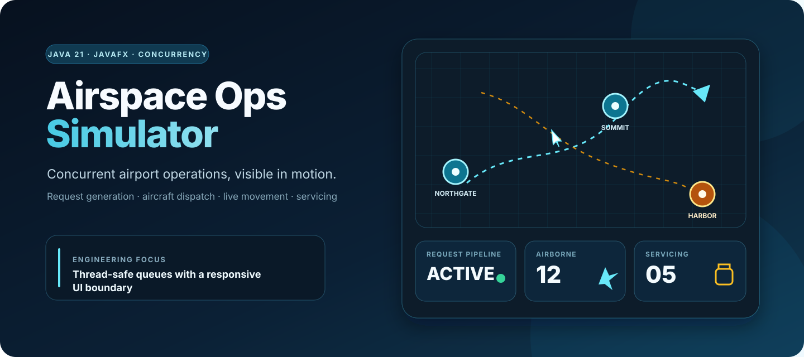
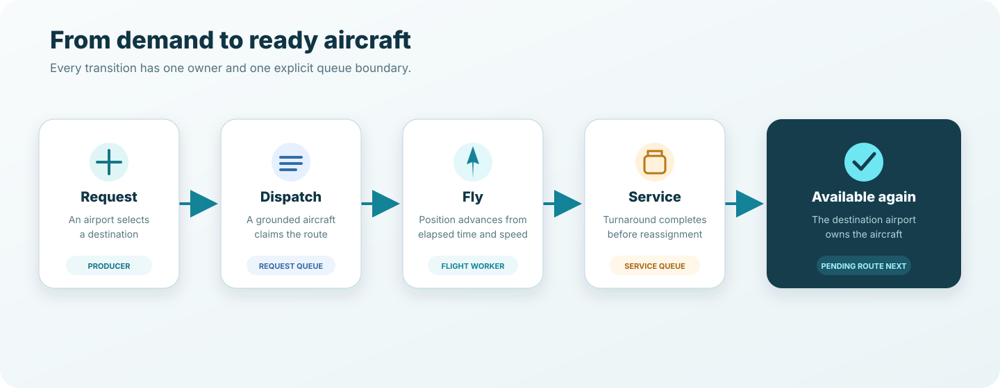
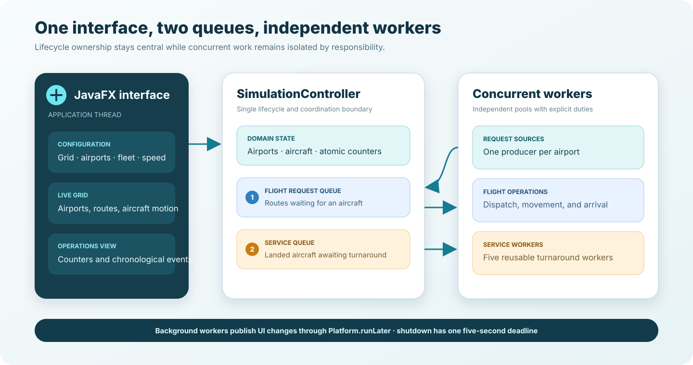

<p align="center">
  
</p>

<p align="center">
  <a href="https://github.com/Himath2002/airspace-ops-simulator/actions/workflows/ci.yml"></a>
  
  
  
  <a href="LICENSE"></a>
</p>

# Airspace Ops Simulator

Airspace Ops Simulator is a configurable JavaFX desktop application that makes concurrent airport operations visible. Independent request producers create demand, a dispatcher assigns available aircraft, flight workers animate movement across the grid, and a dedicated service queue returns landed aircraft to operation.

The result is a compact concurrency case study with a UI you can observe: queues fill and drain, aircraft move between airports, servicing happens in parallel, and live counters expose the system state.

## At a glance

| Area | What is implemented |
| --- | --- |
| Operations model | Airports, aircraft, route requests, flight completion, and turnaround servicing |
| Concurrency | Per-airport request producers, blocking queues, fixed and cached worker pools |
| Live interface | Resizable JavaFX grid, animated aircraft, event log, and operational counters |
| Configuration | Grid dimensions, airport count, fleet size per airport, and movement speed |
| Lifecycle | Restart-safe state reset, daemon request sources, interruption, and bounded shutdown |
| Quality gate | Java compiler warnings, project-specific PMD rules, and GitHub Actions |

## What you can observe

- Airports are placed in distinct grid columns to avoid visual overlap.
- Every airport generates route requests independently.
- A request waits when its origin has no grounded aircraft.
- An available aircraft moves according to elapsed time and the configured speed.
- Landed aircraft enter a separate service queue before becoming available again.
- The status bar reports airborne aircraft, aircraft in service, and completed flights.
- The event stream records departures, arrivals, initialization, and lifecycle problems.

## Operations lifecycle

<p align="center">
  
</p>

A route request does not reserve an aircraft in advance. The dispatcher polls the origin airport when work is processed; if the local fleet is busy, the request moves to that airport's pending queue. The next serviced aircraft re-enqueues one pending route, keeping the workflow demand-driven without a polling loop.

## Run locally

### Prerequisite

- JDK 21. The Gradle wrapper is included; a system Gradle installation is not required.

Confirm Java is available:

```bash
java -version
```

### Launch the simulator

macOS or Linux:

```bash
./gradlew :gui:run
```

Windows:

```powershell
gradlew.bat :gui:run
```

Use the toolbar to configure the simulation and select **Start simulation**. Select **Stop** before starting another run.

### Default configuration

| Setting | Default | Validation |
| --- | ---: | --- |
| Grid width | `12` | Values below `2` are raised to `2` |
| Grid height | `12` | Values below `2` are raised to `2` |
| Airports | `10` | Clamped between `2` and the grid width |
| Aircraft per airport | `10` | Must be at least `1` |
| Aircraft speed | `1.2` | Must be positive |

## Architecture

<p align="center">
  
</p>

The modules and packages follow runtime responsibilities:

| Boundary | Responsibility |
| --- | --- |
| `gui` module | JavaFX application, drawing surface, domain state, lifecycle controller, and resources |
| `comms` module | Independent route-demand production and aircraft service timing |
| `app` | Window construction, validated configuration, and start/stop actions |
| `controller` | The single coordination boundary for queues, pools, counters, and shutdown |
| `model` | Thread-safe airport and aircraft state plus immutable flight requests |
| `gui` package | Resizable canvas renderer and cross-thread icon render state |
| `simulation` | Request source and service operations used by controller workers |

### Concurrency map

| Component | Execution model | Shared boundary |
| --- | --- | --- |
| JavaFX interface | JavaFX application thread | Receives background updates through `Platform.runLater` |
| Request sources | One fixed-pool worker and one daemon producer per airport | `BlockingQueue<FlightRequest>` |
| Flight operations | Cached worker pool | Airport fleet queue and atomic counters |
| Service operations | Five reusable workers | `BlockingQueue<Plane>` |
| Airport availability | Lock-free concurrent queue | One grounded-aircraft pool per airport |
| Aircraft lifecycle | Atomic state plus volatile position/ownership | Renderer reads current state safely |

## Inputs and outputs

| Input | Effect | Visible output |
| --- | --- | --- |
| Grid dimensions | Defines the logical operating surface | Rescaled grid and airport placement |
| Airport count | Controls request producers and destinations | Airport icons and names |
| Aircraft per airport | Sets local dispatch capacity | Aircraft icons and queue availability |
| Aircraft speed | Controls distance advanced per elapsed second | Movement duration |
| Start / stop actions | Own the worker lifecycle | Counters, log messages, and clean termination |

The simulator is entirely local. It does not use an API key, network service, database, or live aviation feed.

## Verification

Run the same quality gate used by CI:

```bash
./gradlew clean check
```

Useful focused commands:

```bash
# Compile both modules with Java warnings enabled
./gradlew classes

# Run PMD against the request/service module
./gradlew :comms:pmdMain

# Run PMD against the JavaFX application
./gradlew :gui:pmdMain
```

PMD reports are written to each module's `build/reports/pmd/` directory. The current verification gate covers compilation and static analysis; graphical startup is additionally exercised through a desktop launch smoke check.

## Project structure

```text
airspace-ops-simulator/
├── .github/
│   ├── workflows/ci.yml                 # Java 21 compile and PMD workflow
│   └── dependabot.yml                    # Monthly dependency maintenance
├── buildSrc/
│   └── src/main/groovy/
│       └── java-conventions.gradle       # Shared Java and PMD conventions
├── comms/
│   └── src/main/java/io/github/himath2002/airspace/simulation/
│       ├── AircraftService.java          # Turnaround timing
│       └── FlightRequestSource.java      # Independent route demand
├── config/pmd/ruleset.xml                # Project quality rules
├── docs/
│   ├── architecture.svg                  # Runtime boundaries
│   ├── hero.svg                          # Repository overview
│   ├── operations-flow.svg               # Request-to-availability lifecycle
│   └── source-assets/                    # Original runtime artwork sources
├── gui/
│   └── src/main/
│       ├── java/io/github/himath2002/airspace/
│       │   ├── app/                      # JavaFX entry point
│       │   ├── config/                   # Runtime settings
│       │   ├── controller/               # Simulation coordination
│       │   ├── gui/                      # Grid renderer
│       │   ├── model/                    # Airport, aircraft, and request state
│       │   └── ui/                       # User feedback dialogs
│       └── resources/                    # Grid, airport, and aircraft artwork
├── CHANGELOG.md
├── SECURITY.md
└── gradlew
```

## Engineering decisions

- **One lifecycle owner:** `SimulationController` creates and stops every queue, worker pool, counter, and timer used by a run.
- **Explicit back-pressure:** route demand crosses a blocking queue; airport-specific pending queues retain work when no local aircraft is available.
- **Separate turnaround capacity:** service work has its own queue and five stable consumers, so landed aircraft do not block dispatch workers.
- **Elapsed-time movement:** position updates use measured elapsed time rather than assuming a fixed frame rate.
- **Safe UI boundary:** workers update render state and schedule JavaFX layout/status work on the application thread.
- **Bounded termination:** both executors share one five-second shutdown deadline rather than waiting indefinitely.
- **Fail-fast resources:** missing image resources stop initialization with a clear error instead of producing a later null failure.

## Scope and limitations

- This is an operations-concurrency simulation, not an air-traffic-control or flight-planning system.
- Routes are direct movements between airport coordinates; weather, altitude, separation, fuel, and collision avoidance are outside scope.
- Request timing, airport rows, and therefore each run's event order are intentionally non-deterministic.
- The event log is session-local and is not persisted.
- The desktop UI requires a graphical environment; CI verifies compilation and static analysis without opening JavaFX.

## License

Released under the [MIT License](LICENSE).

Designed and implemented by [Himath Ahangama](https://github.com/Himath2002).
